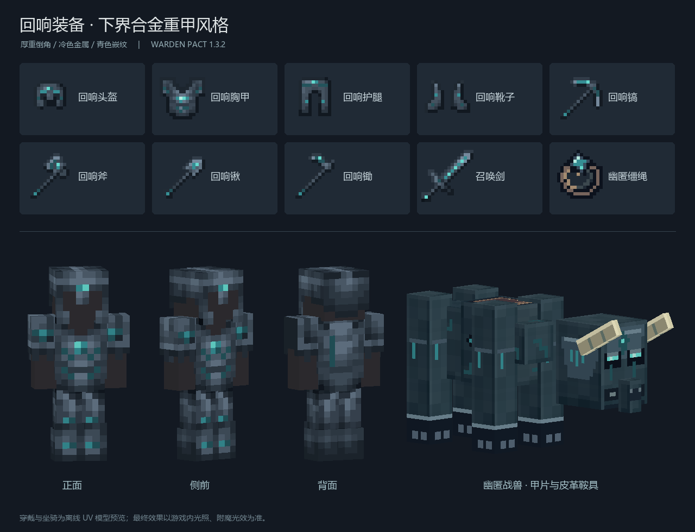

# 坚守者契约 · Fabric 26.3

这是 Warden Pact 的 **Minecraft Java 26.3 / Fabric** 版本，包含召唤、装备、附魔和幽匿战兽坐骑。**1.3.0 新增八件回响装备的自带能力**，无需先附魔。

**1.3.1：回响头盔新增穿戴期间持续夜视**，无需蹲下或附魔；脱下后取消头盔提供的夜视，保留独立的夜视药水效果。原有蹲下侦测能力仍可使用。

**1.3.2：装备外观更新**。盔甲、召唤剑和工具以原版下界合金贴图的轮廓、倒角和明暗结构为基础，改为冷色金属并加入少量青色回响嵌纹。盔甲沿用原版穿戴模型，用甲片高光和接缝阴影表现厚重感；同步更新幼年穿戴贴图（采用对应的 64×64 UV）、幽匿缰绳和战兽皮肤，调整战兽鞍具到朝上的背部 UV 面。装备属性、技能和头盔夜视均保持不变。



## 安装

1. 安装 Minecraft Java **26.3**、**Fabric Loader 0.20.1 或更新版本**，游戏使用 **Java 25**。
2. 将适配 26.3 的 **Fabric API 0.167.0+26.3 或更新版本**与本模组的 `wardenpact-fabric-26.3-1.3.2.jar` 一起放入游戏实例的 `mods` 文件夹。
3. 多人游戏时，客户端和服务器都要安装 Fabric API 和本模组。升级时移出旧版 Warden Pact JAR，只保留对应加载器的一个版本。

## 功能

- 剑命中敌对生物并实际造成伤害后，召唤一只友方坚守者；默认持续 60 秒，冷却 20 秒。
- 再次命中其他怪物会切换助战目标；每位玩家最多一只，空闲时跟随主人。
- 不攻击玩家、驯服的宠物或友方坚守者，不施加黑暗，不掉落物品和经验；临时召唤物不保存到世界。
- 回响头盔、胸甲、护腿、靴子，以及回响镐、斧、锹、锄，使用下界合金级基础属性、独立物品贴图和盔甲穿戴贴图。
- 斧去皮、锹铺路、锄耕地均使用 26.3 原版工具组件。
- 新增回响装备支持铁砧维修，材料为回响碎片或下界合金锭；掉落物防火不代表穿戴者免疫火焰。

## 回响装备自带能力（Fabric 1.3.0）

八件回响装备除了下界合金级基础属性，还各有一项独立能力；**单件即可生效，无需凑套装或附魔**。物品提示中提供中英文能力说明。原有三种附魔仍可使用。

| 装备 | 能力 | 触发与限制 |
| --- | --- | --- |
| 回响头盔 | 永久夜视；幽匿感知：使 16 格半径内的怪物发光 5 秒，可隔墙辨认位置 | 夜视在穿戴期间持续生效；感知需蹲下触发，持续蹲下会在冷却结束后再次侦测，冷却 8 秒 |
| 回响胸甲 | 回响反震：对 4 格半径内怪物造成 4 点基础伤害并击退 | 受到 4 格内怪物造成的实际伤害时触发；冷却 8 秒，环境伤害和远处攻击不触发 |
| 回响护腿 | 幽匿疾行：移动速度提升 15% | 穿戴立即生效，脱下取消 |
| 回响靴子 | 回响缓冲：摔落伤害降低 50% | 穿戴生效，按原版伤害取整，可继续搭配摔落保护附魔 |
| 回响镐 | 矿脉共鸣：连锁采掘最多 16 块相邻的同种矿石 | 主手持镐，蹲下右键矿石；冷却 2 秒 |
| 回响斧 | 林木共鸣：连锁砍伐最多 16 块相邻的同种原木 | 主手持斧，蹲下右键原木；冷却 2 秒 |
| 回响锹 | 回响铺路：将 3×3 区域内适用的地面变为土径 | 主手持锹，蹲下右键地面顶部；冷却 2 秒 |
| 回响锄 | 回响耕作：将 3×3 区域内适用的地面变为耕地 | 主手持锄，蹲下右键地面顶部；冷却 2 秒 |

- 头盔和胸甲不会将玩家、被动生物、已驯服的宠物、友方坚守者、幽匿战兽或队友当作敌人。发光使用原版效果，附近其他玩家也能看见；反震伤害会受目标护甲等正常减伤影响，不会额外触发挥剑召唤。
- 工具不蹲下时保留普通操作，例如斧去皮、锹单格铺路和锄单格耕地。区域技能先处理点击的中心；中心不符合原版转换条件时，不会处理邻格或消耗技能冷却。
- 连锁只沿六个面相邻的同种方块延伸，范围不超过起点 8 格；矿石包括主世界各类矿石、下界金矿、下界石英矿和远古残骸。不会把普通石头、其他种类矿石或木板一起清掉。
- 生存模式下，连锁采掘和伐木通过玩家正常破坏流程逐块计算掉落与耐久，保留精准采集、时运和耐久附魔的原版结算；工具损坏后立即停止。区域转换也按实际成功的方块数逐块消耗耐久。
- 技能检查游戏模式、交互权限、世界边界及区块加载状态；冒险和旁观模式不能发动技能，创造模式不消耗耐久，也不会因连锁破坏生成掉落物。

## 附魔

| 附魔 | 最高等级 | 效果 |
| --- | --- | --- |
| 契约共鸣 | III | 剑：每级延长召唤 15 秒、缩短冷却 3 秒；默认满级持续 105 秒、冷却 11 秒 |
| 幽匿守护 | IV | 盔甲：每件每级减少 2% 敌对生物伤害，满套 IV 合计 32% |
| 回响采掘 | III | 主手采掘工具：每级增加 20% 挖掘速度，满级增加 60% |

三种附魔加入普通附魔台、常规附魔书交易和随机附魔战利品的附魔池。实验性村民交易重平衡使用独立交易池。

锻造台配方：**下界合金升级锻造模板 + 对应下界合金装备 + 回响碎片**。四件盔甲、四种工具和召唤剑均可升级，保留原装备的附魔、自定义名称和已损耗耐久。

物品、附魔指令及原有召唤剑配方见仓库根目录的 README。两版保持相同的物品和附魔 ID。

## 幽匿战兽坐骑（Fabric 1.2.0）

在工作台将 **回响碎片 + 鞍 + 幽匿感测体**无序合成，得到一件可反复使用的 **幽匿缰绳**。创造模式位于“工具与实用物品”，也可用指令获取：

```mcfunction
/give @s wardenpact:sculk_reins
```

- 手持缰绳对空气使用，召唤属于自己的幽匿战兽；已有坐骑时召回原来的那一只，保留血量。每人最多一只，缰绳冷却 **2 秒**。
- 右键战兽上坐骑，**WASD** 控制方向，**按住并松开空格**蓄力跳跃，**Shift** 下坐骑；按键以游戏绑定为准。
- 蹲下对空气使用缰绳可解散坐骑；骑乘中需先落地才能解散，召回前需先下坐骑。
- 战兽有 **60 点生命（30 颗心）、8 点护甲**，移动速度属性为 **0.28**、跳跃强度为 **0.7**。离开骑乘状态后会跟随主人。
- 仅主人能骑乘和喂食。手持回响碎片右键受伤的坐骑，消耗一片恢复 **8 点生命（4 颗心）**。
- 使用掠夺兽体型和原创幽匿贴图，保留原版马的控制与跳跃机制。无需再装鞍，没有储物栏或装备界面，也不能繁殖。
- 骑乘时仍可挥剑命中怪物，召唤和指挥原有的友方坚守者；友方坚守者的近战和音波不会伤害战兽。战兽本身是交通坐骑，不会主动攻击。
- 坐骑免疫火焰，但骑手仍可能受到环境伤害。除友方坚守者伤害外，战兽可以正常受伤和死亡。
- 坐骑是**临时契约召唤物**，不设固定持续时间，不保存到世界。主人死亡、离线、切换维度、坐骑所在区块卸载或退出世界后消失；缰绳可再次召唤。没有物品、内部马鞍或经验掉落。
- 附近需要安全的固体落脚点和约 **2 格宽、3 格高**的空间；空间不足时不会消耗冷却，召回失败也不会移动原坐骑。

坐骑和装备自带能力仅加入 Fabric 26.3 版；NeoForge 26.2 版仍为 1.1.0。

## 配置

首次进入世界或启动服务器后，生成 `config/wardenpact-fabric.properties`。配置由服务端读取，修改后重新进入世界或重启服务器生效。

```properties
anySwordSummons=true
cooldownSeconds=20
lifetimeSeconds=60
defendRadius=24
```

冷却范围 1–3600 秒，召唤时间 5–3600 秒，防卫半径 4–48 格。非法数字使用默认值，超范围数字限制到有效范围。NeoForge 的 TOML 配置不会被 Fabric 版自动读取。

## 构建与测试

在本目录运行，需要 JDK 25：

```powershell
.\build.ps1
.\gradlew.bat runGameTest
.\gradlew.bat runClient
```

也可在仓库根目录执行 `.\fabric\gradlew.bat -p fabric build runGameTest`。

产物位于本目录的 `build/libs/wardenpact-fabric-26.3-1.3.2.jar`。不要安装 `-sources.jar`。

服务端游戏测试包括原有召唤、装备和附魔回归测试，以及坐骑召唤、原版骑乘输入和跳跃、主人权限、治疗、召回与冷却、空间不足处理、解散、骑乘中挥剑召唤、友军保护、跟随与离线清理、死亡不掉鞍和缰绳配方。

1.3.0 增加装备能力测试：头盔侦测半径、过滤及冷却；胸甲真实受击反震、击退及冷却；护腿与靴子的实际属性和摔伤、脱下后清除加成；连锁掉落、精准采集、时运、16 块上限、耐久及中途损坏；3×3 铺路和耕作、障碍物与无效中心；冒险、旁观、创造模式及技能冷却。

1.3.1 增加头盔夜视测试：仅头部穿戴生效、持续刷新及避免临近到期闪烁、脱下后取消、清除效果后恢复，以及保留穿戴前后施加的普通夜视药水效果。

Fabric 和 NeoForge 工程共享根目录 `src/main/resources` 中的贴图、配方、标签及附魔数据，因此构建时应保留完整仓库目录结构。两套 Java 代码和加载器元数据独立；测试代码、测试模组和场地不会打进正式模组 JAR。
