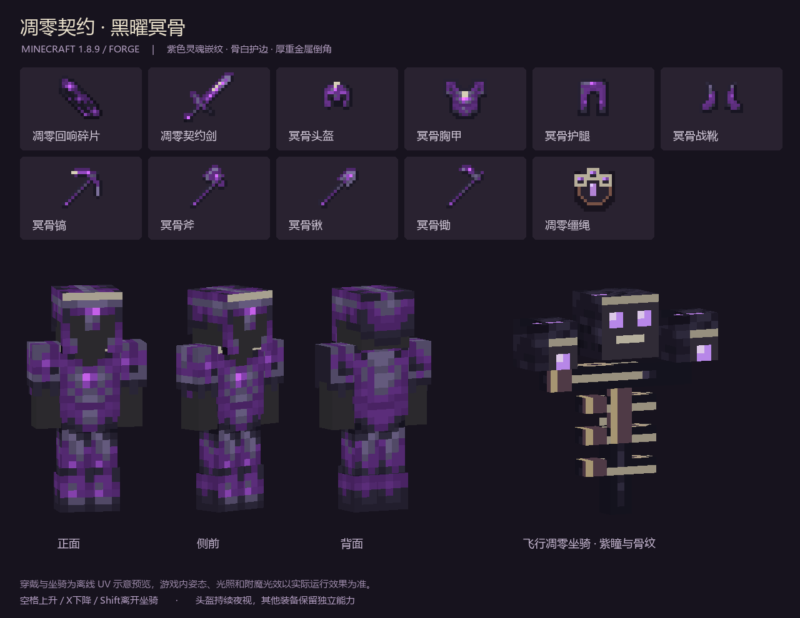

# 凋零契约 · Wither Pact（Forge 1.8.9）

这是独立的 **Minecraft Java 1.8.9 / Forge 11.15.1.2318** 分支。剑命中敌对生物会召唤友方凋零；专属坐骑也是可飞行的凋零。保留回响装备的独立能力、三种附魔和头盔持续夜视，外观改为紫黑金属、骨白护边和紫色灵魂嵌纹。



## 安装

1. 安装 Minecraft **1.8.9 + Forge 11.15.1.2318**，使用 **Java 8**。
2. 把 `witherpact-forge-1.8.9-1.0.0.jar` 放入这个实例的 `mods` 文件夹。客户端、服务器都需要安装。
3. 从创造模式的“凋零契约”分页取出装备，或使用下面的指令。

不要同时放入测试 JAR、源码 JAR，也不要把 26.2 NeoForge / 26.3 Fabric 的 JAR 放入 1.8.9 实例。

```mcfunction
/give @p witherpact:summoning_sword
/give @p witherpact:wither_reins
/give @p witherpact:echo_helmet
/give @p witherpact:echo_chestplate
/give @p witherpact:echo_leggings
/give @p witherpact:echo_boots
/give @p witherpact:echo_pickaxe
/give @p witherpact:echo_axe
/give @p witherpact:echo_shovel
/give @p witherpact:echo_hoe
/give @p witherpact:echo_shard 16
```

## 召唤与坐骑

- 用任意剑对敌对生物造成近战伤害：召唤友方凋零。默认持续 **60 秒**，冷却 **20 秒**，每人最多一只；指挥现有凋零不会刷新持续时间。
- 助战凋零会攻击你命中的敌人，并搜寻主人周围 24 格内的敌对生物。特殊骷髅弹只伤害敌对生物，不爆炸、不破坏地形，不攻击玩家、宠物或其他契约凋零。
- **凋零缰绳右键**：召唤或召回自己的凋零坐骑；再对凋零右键即可骑乘。坐骑与助战单位分别计数，可同时存在。
- **WASD**：水平移动；**空格**：上升；**X**：下降（可改键）；**Shift**：离开坐骑。坐骑可悬停飞行，不主动攻击。上升高度受建筑高度限制。
- 潜行使用缰绳遣散未载人的坐骑；骑乘期间不能直接遣散。下坐骑后提供限时缓降与摔落保护，落地后结束。
- 坐骑有 **60 点生命、8 点护甲**；拿碎片对它右键恢复 **8 点生命**，消耗一片。召回不会补满生命，其他玩家不能骑乘或治疗。
- 主人死亡、离线、切换维度，或退出世界时清除；它们是临时契约实体，不保存、不掉落下界之星和经验。坐骑离开已加载区域后需要重新召唤。

## 装备的实际能力

| 装备 | 自带能力 |
| --- | --- |
| 冥骨头盔 | 穿戴持续夜视；潜行侦测 16 格内敌对生物，以紫色边框标记 5 秒，冷却 8 秒 |
| 冥骨胸甲 | 受到 4 格内敌人实际伤害，触发半径 4 格、基础 4 点伤害的击退脉冲，冷却 8 秒 |
| 冥骨护腿 | 穿戴移动速度 +15%，不会重复叠加 |
| 冥骨战靴 | 摔落伤害减少 50% |
| 冥骨镐 | 潜行右键矿石，连锁开采相同矿石，最多 16 块、距起点 8 格内，冷却 2 秒 |
| 冥骨斧 | 潜行右键原木，连锁砍伐相同原木，最多 16 块、距起点 8 格内，冷却 2 秒 |
| 冥骨锹 | 右键开路；潜行右键处理 3×3 土地，冷却 2 秒 |
| 冥骨锄 | 潜行右键耕作 3×3 土地，冷却 2 秒 |

工具正常消耗耐久，连锁开采走服务端原版收获流程，保留时运、精准采集等掉落规则；不在冒险模式生效，并尊重方块编辑/破坏事件。周围土地只处理同高度可用方块。护甲每件提供 10% 击退抗性，整套 40%。

剑和工具耐久 2031，工具采掘速度 9，镐可以采掘黑曜石。整套护甲 20 点护甲值，使用对应的厚重立体穿戴模型和专属贴图；面甲、护肩、膝甲和靴尖为随身体动作移动的立体甲片。可以在铁砧中用碎片或钻石维修。

## 合成与附魔

用骨头、黑曜石与下界之星合成 **8 片凋零回响碎片**：

```text
骨头    黑曜石    骨头
黑曜石  下界之星  黑曜石
骨头    黑曜石    骨头
```

对应的 **钻石装备 + 1 片碎片**，工作台无序升级为契约剑或冥骨装备，保留自定义名称、附魔、其他 NBT 和已消耗耐久。**碎片 + 鞍 + 灵魂沙**，无序合成凋零缰绳。

| 附魔 | 上限 | 效果 |
| --- | --- | --- |
| 契约共鸣 | III | 剑：每级让新助战凋零多存在 15 秒、冷却减少 3 秒；III 为 105 秒 / 11 秒 |
| 幽匿守护 | IV | 盔甲：每件每级减少 2% 敌对生物伤害，满套 IV 合计 32%；不减免摔落、岩浆或玩家伤害 |
| 回响采掘 | III | 手持采掘工具：每级挖掘速度 +20%，III 为 +60% |

三种附魔可从普通附魔台获得，也能通过附魔书和铁砧使用。首次运行生成 `config/witherpact.cfg`，可调整召唤持续时间、冷却、搜索距离和附魔数字 ID。默认 ID 为 120、121、122；与其他模组冲突时需改为未占用且互不相同的 ID，客户端与服务器保持一致。

## 旧版本适配说明

- 1.8.9 没有坚守者，替换为友方凋零与飞行凋零坐骑。
- 没有原版发光效果，头盔侦测使用专用客户端边框，不改变实体药水状态。
- 没有下界合金、锻造台、护甲韧性，采用独立材料属性和钻石装备升级配方；不宣称原版韧性属性。
- 没有土径，新增对应土径方块；没有原木去皮机制，斧保留连锁伐木能力。
- 掉落装备遵循 1.8.9 普通物品实体规则，不继承现代版的物品防火属性。
- 预览图是离线 UV 示意，不是游戏截图。服务端测试覆盖核心逻辑；实际客户端骑乘手感与其他模组兼容性仍需进游戏体验。

## 开发

需要 **Java 8 JDK** 和 Gradle 2.14.1（wrapper 已固定）。Windows：

```powershell
./build.ps1 -JavaHome 'C:/path/to/jdk8'
```

首次构建需要下载官方 Forge/Minecraft 依赖；旧版 ForgeGradle 会显示“不再受支持”的提示。源码使用 MCP stable_22 映射。发行包只包含本模组代码和资源，不包含 Minecraft。

`src/smoke/java` 是独立的服务端集成测试模组，不进入正式 JAR。在隔离的开发 `run` 目录准备服务端测试配置后，使用 `./build.ps1 -Smoke`；脚本跳过服务端不需要的客户端资源下载，测试会写出 `run/witherpact-smoke-results.json` 并停止服务端。依赖已齐全时可添加 `-Offline`。

2026-11-28 已在 Forge 11.15.1.2318 的开发专用服务器运行：**86 项检查通过，0 项失败**。覆盖注册与附魔规则、保留 NBT 的升级配方、剑命中召唤与冷却、凋零归属和存活时间、坐骑升降与输入过期、治疗/召回/遣散、离骑保护、安全骷髅弹、持续夜视、护甲能力、真实开采与 3×3 土地处理、方块权限事件以及网络包边界。测试环境仅绑定本机回环地址。

客户端渲染代码已编译、资源文件已校验；没有将离线预览当作游戏实机截图，实际画面、骑乘手感和第三方模组兼容性仍需进游戏确认。
